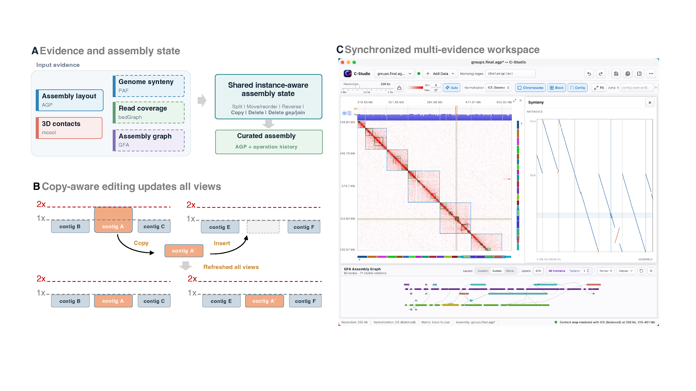

# C-Studio

       [](https://github.com/wangyibin/C-Studio/releases)

> ⚠️ **Development status:** C-Studio is under active development. Features and interfaces may change.

C-Studio is a desktop application for visual inspection and user-directed
editing of chromosome-scale genome assemblies. It brings AGP layouts together
with Hi-C contact maps, synteny alignments, coverage tracks, and assembly-graph
evidence in one synchronized workspace, while keeping the edited AGP layout as
the source of truth.



## Example data

Download [`examples.tar.gz`](https://github.com/wangyibin/C-Studio/releases/download/v0.5.0/examples.tar.gz)
from the [C-Studio v0.5.0 release](https://github.com/wangyibin/C-Studio/releases/tag/v0.5.0).
Extract the archive, then load an extracted project directory with
**Add Data → Load project folder…**.

The archive contains these example files:

```text
groups.final.agp
alfalfa.mapq1.mcool
alfalfa.coverage.bedgraph
ref.align.paf
alfalfa.p_utg.noseq.gfa
```

## Documentation

- English: [online documentation](https://wangyibin.github.io/C-Studio/latest/)
- 中文：[在线文档](https://wangyibin.github.io/C-Studio/zh/latest/)
- Remote files / 远程文件：[English](docs/en/user-guide/remote-contact-service.md) · [中文](docs/zh/user-guide/remote-contact-service.md)

## Tests and reproducibility

[](https://github.com/wangyibin/C-Studio/actions/workflows/tests.yml)

C-Studio includes TypeScript and Rust tests for assembly editing, AGP
import/export, operation history, contact-map processing and related components.
A small synthetic workflow checks curation, undo/redo, saving and reopening
against reviewed AGP outputs; a Rust integration test checks Cooler I/O and
contact values before and after curation, with and without caching.

```bash
npm ci
npm test
npm run build
```

See [TESTING.md](TESTING.md) for Rust commands, dependencies, coverage and
limitations, and the [fixture description](tests/fixtures/curation/README.md)
for the reference calculations. With Docker and `act` installed,
`npm run test:local-ci` runs the Ubuntu CI jobs locally as `linux/amd64`.
The Tests workflow runs on pushes and pull
requests and preserves test reports. Use the report for the specific commit
when reporting validation results.

## Desktop release builds

Pushing a `v*` tag automatically builds and publishes macOS Apple Silicon,
macOS Intel, Windows x86-64, and Linux x86-64 packages. The tag must match the version in
`package.json`, `src-tauri/tauri.conf.json`, and `src-tauri/Cargo.toml`.
You can also run **Package desktop apps and cool2mcool** in GitHub Actions. Set
`release_tag` to an existing `v*` tag to publish the packages and `SHA256SUMS`
to its GitHub Release; leave it empty to upload workflow artifacts only.

macOS packages use separate architecture names: `C-Studio-arm64.app.zip` and
`*_aarch64.dmg` for Apple Silicon, `C-Studio-x64.app.zip` and `*_x64.dmg` for
Intel. Linux packages are `C-Studio_<version>_amd64.deb` and
`C-Studio_<version>_amd64.AppImage`, built on Ubuntu 22.04. The release workflow
requires all four desktop variants, including both Linux formats, before publishing.

For a Linux x86-64 build, install the [Linux system dependencies](docs/en/installation.md),
then run on Linux:

```bash
pixi run --locked -e package package-linux
```

Outputs are under `src-tauri/target/x86_64-unknown-linux-gnu/release/bundle/`.
The Linux build statically links HDF5 and checks the executable architecture,
Debian package metadata, and both package files. Linux ARM64 desktop packaging
is not included.

For a local macOS release build, run:

```bash
pixi run --locked -e package package-macos
```

The packaging task builds for the current Mac's architecture and bundles its
matching Pixi `libiconv` dependency. Outputs are under
`src-tauri/target/aarch64-apple-darwin/release/bundle/` on Apple Silicon or
`src-tauri/target/x86_64-apple-darwin/release/bundle/` on Intel.

To build the Intel release on an Apple Silicon Mac with Rosetta installed:

```bash
pixi run --locked -e package-intel package-macos
```

The separate `package-intel` environment runs Intel Node.js and Rust under
Rosetta and bundles the Intel `libiconv` dependency. It produces the app and
DMG under `src-tauri/target/x86_64-apple-darwin/release/bundle/`.

Build all desktop packages on an Apple Silicon Mac with Rosetta, Docker Desktop
with Buildx, and the Windows cross-packaging tools listed below:

```bash
pixi run --locked -e package release-local
```

The command starts Docker Desktop if needed and builds the Linux x86-64
`.deb` and `.AppImage` from the current checkout in Ubuntu 22.04. It then
builds macOS ARM64 and Intel (a DMG and an app ZIP each) and Windows x86-64
(an NSIS `-setup.exe`). The first Docker build downloads the Linux toolchain.

All seven packages and their `SHA256SUMS` go into `output/releases/v<version>/`
after validation. The script restores the native frontend dependencies after
the builds. A failed build keeps its staging directory. A successful rebuild
backs up the previous complete version before replacing it.

Windows cross-packaging requires `cargo-xwin`, NSIS, and Wine (see
`scripts/package-windows-from-macos.sh`); Pixi provides the LLVM tools and
Windows Rust standard library. Local macOS builds produce the Windows `.exe`;
the GitHub workflow also produces `.msi` on its Windows runner.

To build and publish the same seven packages from this Mac:

```bash
pixi run --locked -e package release-local --publish
```

This requires an authenticated GitHub CLI (`brew install gh` followed by
`gh auth login`), a clean checkout of the
matching tag, and that same tag already pushed to `origin`. It creates a draft,
checks that all packages were uploaded, then publishes it. If the tag-triggered
workflow is enabled, let that workflow publish; use `--publish` when its
automatic publication is disabled. An existing Release is not overwritten
by the local script.
