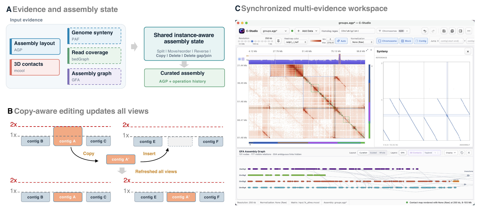
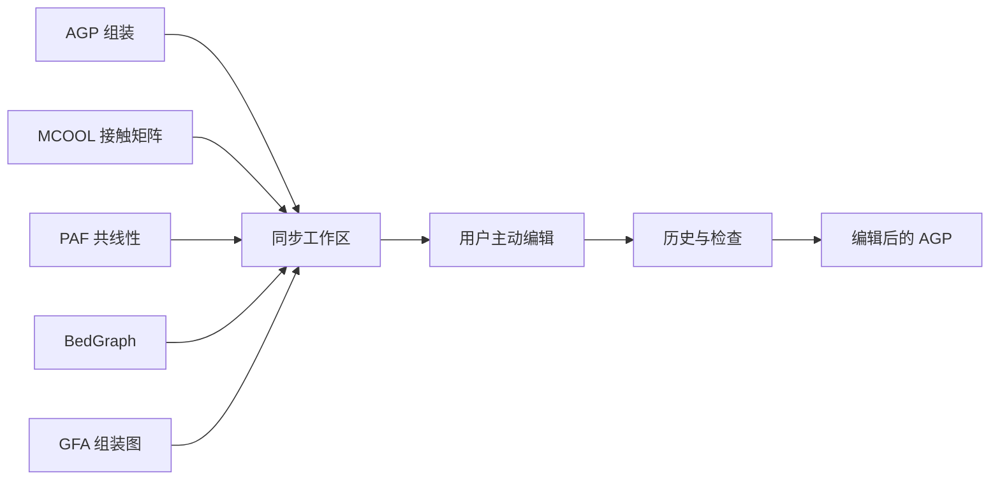

# C-Studio
      

> ⚠️ **开发状态：**C-Studio 仍处于早期开发阶段，功能和界面可能发生变化。

C-Studio 是用于检查和手动校订染色体级基因组组装的桌面应用。你可以结合接触图、
共线性、覆盖度和组装图，调整 AGP 中的序列顺序、方向和位置。各证据视图会随
组装编辑同步更新，便于对照编辑前后的结果。

当前应用使用 Tauri 2、React、TypeScript 和 Rust 构建。

*图 1｜C-Studio 在同一工作区中展示 AGP 组装布局、三维接触、共线性、覆盖度和
组装图，并能区分同一源序列的不同拷贝。各视图随编辑同步更新。*

!!! important "校订结果需要由用户判断"

    本文档介绍当前已实现的功能。C-Studio 提供用于校订的证据和编辑工具，
    断点、方向、分组和拷贝数是否符合生物学实际，仍需由用户判断。

## 可以加载和编辑什么

AGP 定义组装结构。你可以选择和编辑其中的 contig，区分同一源序列的不同拷贝，
并导出编辑后的 AGP。编辑过程会记录操作历史，支持撤销和重做；随 AGP 保存的
历史文件与组装匹配时，重新打开项目后也能恢复编辑历史。

校订时可以对照以下证据：

- `.mcool` 接触矩阵；
- PAF 共线性比对；
- BedGraph 覆盖度轨道；
- GFA 组装图，以及可选的序列端点之间的三维接触证据。

## 组装布局与证据的关系

序列的排列顺序、方向、边界及导出结果均以当前 AGP 组装布局为准。接触矩阵、PAF、
覆盖度和 GFA 按照这一布局显示，原始证据数据不会因组装编辑而被改写。所有编辑
都需要由用户发起。

## 从这里开始

1. [安装或构建 C-Studio](installation.md)。
2. [准备 AGP 和证据文件](user-guide/input-preparation.md)。
3. 按照[快速开始](getting-started.md)加载数据、尝试编辑并保存结果。
4. 加载真实数据前，阅读[项目数据](user-guide/project-data.md)，了解目录扫描和文件选择规则。
5. 启用自动保存或删除拷贝前阅读[组装编辑](user-guide/assembly-editing.md)。

[当前限制](reference/limitations.md)说明了已实现的功能，以及安装包、平台支持和
验证方面尚未完成的工作。
